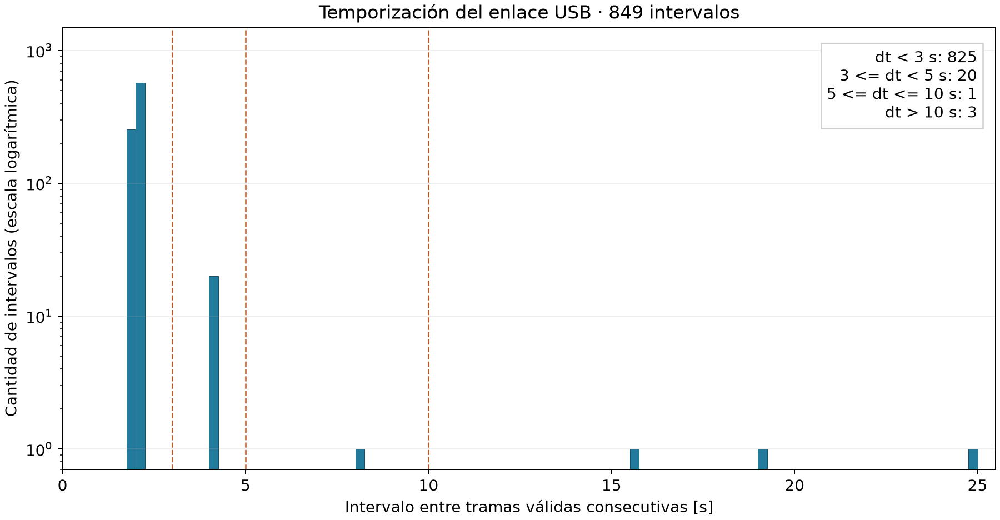

# Laboratorio Evaluado 3: respuestas de las preguntas 1-5

**Alcance:** parte base del trabajo en pareja. Este texto se debe integrar con las
preguntas 6-11 para producir el informe PDF final; por sí solo no es la entrega
completa. Todos los resultados provienen de los dos archivos proporcionados.

## 1. Validación de tramas

Se implementó `validar(linea)` en `pipeline.py`. La función retorna los campos
numéricos y `ok` cuando la trama supera las verificaciones; en caso contrario,
retorna `None` y la primera causa de rechazo según esta prioridad:

1. **basura:** el texto recibido no comienza con `$`.
2. **truncada:** no existe `*` o el checksum no consta exactamente de dos
   caracteres hexadecimales.
3. **checksum:** el XOR de los códigos de los caracteres entre `$` y `*`, sin
   incluir estos delimitadores, difiere del checksum recibido.
4. **formato:** el identificador no es `CPS`, el cuerpo no contiene siete campos
   o no se pueden convertir los campos a sus tipos numéricos correspondientes.

`seq`, `t_ms`, `a0`, `pulsos` y `boton` se convierten a enteros; `t_mcu`, a real
finito. Esta función no evalúa continuidad temporal ni plausibilidad física.
Por lo tanto, una medición alterada con checksum recalculado puede ser aceptada.

El archivo tiene 868 líneas en total, de las cuales dos son comentarios.

| Clasificación | Cantidad |
|---|---:|
| Líneas de datos, excluidos comentarios | 866 |
| Tramas válidas | 850 |
| Rechazos por basura | 3 |
| Rechazos por truncada | 4 |
| Rechazos por checksum | 9 |
| Rechazos por formato | 0 |
| Rechazos totales | 16 |

Se comprueba que 850 + 3 + 4 + 9 + 0 = 866. La ausencia de rechazos por
`formato` en la captura no elimina la necesidad de implementar esa condición.

**Codificación.** El archivo debe abrirse con `encoding="utf-8"` porque ese es
su formato declarado y contiene caracteres no ASCII en las líneas de basura.
Depender de la codificación predeterminada del sistema puede producir una
decodificación incorrecta o una excepción, según el entorno. Especificar UTF-8
permite conservar fielmente el texto recibido para su almacenamiento y análisis.
No se usa `errors="ignore"` ni una sustitución adicional de caracteres.

## 2. Almacenamiento en SQLite

Se generó `cps_lab3.db` con el esquema exacto del enunciado. Las 850 tramas válidas
se insertaron en `tramas` y las 16 líneas rechazadas, en `rechazos`, conservando
el orden de aparición dentro de cada tabla. Los `id` son correlativos e
independientes en ambas tablas, como en el respaldo. `ts` conserva el texto de
la marca temporal y `linea` conserva el texto recibido, sin la hora y sin el
terminador de línea.

Las dos cargas se realizaron con `executemany`, dentro de una única transacción
explícita con `BEGIN`, `commit()` al terminar y `rollback()` ante un error.

```sql
SELECT COUNT(*) AS n_tramas FROM tramas;      -- 850
SELECT COUNT(*) AS n_rechazos FROM rechazos;  -- 16
SELECT causa, COUNT(*) AS cantidad FROM rechazos GROUP BY causa;
```

Una transacción única evita confirmar cada fila por separado, lo que reduce la
sobrecarga de sincronización y escritura. Además, asegura atomicidad: se confirma
la carga completa o se revierte, evitando una base parcialmente cargada.

Los rechazos se almacenan porque son evidencia de la calidad del canal y de
incidentes de operación. Permiten calcular la cantidad de tramas dañadas,
correlacionar el ruido con las reconexiones y revisar las decisiones del validador.
Descartarlos impediría distinguir corrupción de pérdidas y reduciría la trazabilidad.

## 3. Verificación cruzada

Se adjuntó la base de respaldo mediante `ATTACH DATABASE` y se compararon ambas
bases mediante las consultas incluidas en `consultas.sql`.

| Indicador | Base generada | Respaldo |
|---|---:|---:|
| Cantidad de tramas | 850 | 850 |
| Suma de seq | 99647 | 99647 |
| Suma de a0 | 482689 | 482689 |
| Rechazos por basura | 3 | 3 |
| Rechazos por truncada | 4 | 4 |
| Rechazos por checksum | 9 | 9 |
| Rechazos por formato | 0 | 0 |

```sql
ATTACH DATABASE 'cps_lab3_respaldo.db' AS ref;

SELECT ts,seq,t_ms,t_mcu,a0,pulsos,boton FROM main.tramas
EXCEPT
SELECT ts,seq,t_ms,t_mcu,a0,pulsos,boton FROM ref.tramas;

SELECT ts,seq,t_ms,t_mcu,a0,pulsos,boton FROM ref.tramas
EXCEPT
SELECT ts,seq,t_ms,t_mcu,a0,pulsos,boton FROM main.tramas;
```

Ambas consultas retornan **cero filas**. Se verificaron también los rechazos
en ambos sentidos y la igualdad completa de ambas tablas ordenadas por `id`.
Esta última comprobación incluye orden y multiplicidad, que `EXCEPT` por sí solo
no comprueba. No se encontraron diferencias que requirieran corregir el validador.

## 4. Disponibilidad por tramas

Se numeraron las sesiones con una suma acumulada que aumenta cuando `seq = 1`,
siguiendo el criterio del enunciado:

```sql
WITH numeradas AS (
  SELECT *, SUM(CASE WHEN seq = 1 THEN 1 ELSE 0 END)
    OVER (ORDER BY id ROWS BETWEEN UNBOUNDED PRECEDING AND CURRENT ROW) AS sesion
  FROM tramas
)
SELECT sesion, COUNT(*) AS n_validas, MAX(seq) AS max_seq,
       MIN(ts) AS primera_ts, MAX(ts) AS ultima_ts
FROM numeradas
GROUP BY sesion ORDER BY sesion;
```

No se considera cada descenso de `seq` como un reinicio: existen descensos que
requieren el análisis de seguridad de la pregunta 9. En esta pregunta se mantienen
todas las tramas sintácticamente válidas, tal como exige el enunciado.

| Sesión | Primera trama válida (hora) | Última trama válida (hora) | Nval | Máximo seq |
|---|---|---|---:|---:|
| 1 | 15:00:01.604 | 15:10:59.723 | 319 | 330 |
| 2 | 15:11:18.725 | 15:17:30.793 | 182 | 187 |
| 3 | 15:17:55.623 | 15:24:59.700 | 211 | 213 |
| 4 | 15:25:15.424 | 15:29:59.476 | 138 | 143 |

Todas las horas corresponden al 8 de octubre de 2026.

- Nesp = 330 + 187 + 213 + 143 = **873**.
- Nval = **850**.
- Ncorr = 9 por checksum + 4 truncadas = **13**.
- Nperd = 873 - 850 - 13 = **10**.
- D = 100 × 850 / 873 = **97,3654 %**.

| N.º de sesiones | Nesp | Nval | Ncorr | Nperd | D [%] |
|---:|---:|---:|---:|---:|---:|
| 4 | 873 | 850 | 13 | 10 | 97,3654 |

Las líneas de basura no se consideran tramas porque no comienzan con el
delimitador `$` y no aportan evidencia de una muestra estructurada del Arduino.
Un fragmento de ruido no debe contarse como una trama emitida y dañada. En cambio,
las categorías checksum y truncada se contabilizan como tramas dañadas según la
definición de Ncorr del laboratorio.

## 5. Throughput y temporización

### 5a. Throughput, largo medio y ocupación

Se utilizaron las marcas temporales de la primera y última trama válida:

- Primera: **2026-10-08 15:00:01.604**.
- Última: **2026-10-08 15:29:59.476**.
- T = **1797,872 s**.

El largo de cada trama se midió directamente sobre el texto válido del archivo
crudo, desde `$` hasta el último dígito del checksum, y se sumaron dos bytes por
`\r\n`. No se reconstruyeron las tramas desde SQLite para evitar alterar su
representación numérica original. Las tramas válidas son ASCII, por lo que
su codificación UTF-8 utiliza un byte por carácter.

La suma de los largos de las 850 tramas válidas, incluido CRLF, es **27732 bytes**.
Los largos individuales van de 29 a 35 bytes.

| Magnitud | Cálculo | Resultado |
|---|---|---:|
| X | 850 / 1797,872 | 0,472781 tramas/s |
| L | 27732 / 850 | 32,625882 bytes/trama |
| R | 10 × L × X | 154,249023 bit/s |
| ρ | 100 × R / 115200 | 0,133897 % |

La ocupación calculada es muy baja: el margen nominal restante es aproximadamente
**99,8661 %**, por lo que existe margen de ancho de banda para agregar campos
de nuevos sensores. Este cálculo representa el tráfico válido según la fórmula
solicitada; no incluye el tráfico rechazado ni garantiza capacidad de muestreo,
procesamiento o fiabilidad del nodo. Agregar sensores requiere comprobar también
esas restricciones.

### 5b. Distribución de los intervalos

Se calculó Δt entre marcas `ts` consecutivas, en orden de `id`. Las 850 tramas
generan **849 intervalos**, sin eliminar las separaciones entre sesiones.



| Categoría | Cantidad | Interpretación respaldada por la captura |
|---|---:|---|
| Δt < 3 s | 825 | Recepción a la cadencia nominal de unos 2 s, con pequeñas variaciones de temporización. La cadencia por sí sola no garantiza legitimidad del contenido. |
| 3 ≤ Δt < 5 s | 20 | Intervalos cercanos a 4 s: falta una trama válida intermedia. En 13 casos aparece un rechazo por checksum o truncada entre las dos válidas; en los otros 7 no se recibió la trama intermedia. |
| 5 ≤ Δt ≤ 10 s | 1 | Intervalo de 8,001 s, entre seq 31 y 35 en la sesión 1: faltan tres tramas consecutivas (32, 33 y 34), sin rechazos intermedios. |
| Δt > 10 s | 3 | Interrupciones de 19,002 s, 24,830 s y 15,724 s, acompañadas de reinicio de seq y t_ms y de una línea de basura antes de la primera trama de la nueva sesión. Son compatibles con desconexiones y reaperturas USB; se desarrollan en P6. |

La interpretación temporal concuerda con los conteos: 7 pérdidas aisladas + 3
pérdidas consecutivas = 10 tramas nunca recibidas; los otros 13 intervalos de
aproximadamente 4 s corresponden a las 13 tramas dañadas. El histograma usa
intervalos de clase de 0,25 s y escala logarítmica vertical para que se aprecien
tanto la concentración cerca de 2 s como los eventos poco frecuentes.

## Archivos de evidencia

- `pipeline.py`: validador, carga y comparación completa contra el respaldo.
- `analisis_enlace.py`: consulta de sesiones, métricas, tablas e histograma.
- `consultas.sql`: consultas SQL utilizadas y consultas auxiliares de verificación.
- `test_pipeline.py`: pruebas de las causas de rechazo y de su prioridad.
- `resultados/pipeline.json`: conteos y comparación de bases.
- `resultados/metricas_enlace.json`: métricas sin redondear.
- `resultados/sesiones.csv`: resumen por sesión.
- `resultados/categorias_intervalos.csv`: conteos por categoría temporal.
- `resultados/tramas_analisis.csv`: datos válidos con minuto, dt, sesión y dseq.
- `resultados/intervalos_mayores_3s.csv`: separaciones temporales para su inspección.
- `resultados/histograma_intervalos.png`: figura para incorporar al informe final.

Fuente: enunciado Laboratorio Evaluado N.º 3, `captura_nodo.txt` y
`cps_lab3_respaldo.db`, proporcionados para la actividad.
